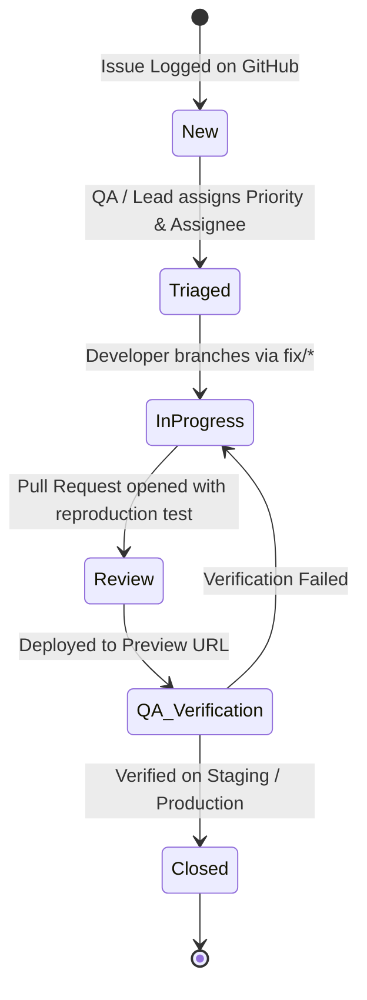

# 🐞 Issue Reporting & Quality Assurance Guide

**Project:** Gera Developments – Hinjewadi, Pune  
**Audience:** Company Technical Team, QA Specialists, Product Owners & Developers  
**Repository:** [24krealtorshinjewadi-blip/Gera-Hinjewadi](https://github.com/24krealtorshinjewadi-blip/Gera-Hinjewadi)

---

## 1. 📌 Overview

To ensure the long-term reliability and code quality of the **Gera Developments – Hinjewadi** platform, this document defines the formal protocol for reporting defects, requesting enhancements, and managing bug lifecycles.

All issues must be tracked through the **GitHub Issues** tab using the provided templates.

---

## 2. 🚦 Severity & Priority Matrix

When submitting an issue, assign the appropriate severity tier based on business impact:

| Severity Level | Definition | Example Scenario | Target Response SLA | Target Resolution SLA |
| :--- | :--- | :--- | :--- | :--- |
| **P0 – Blocker** | Critical production failure affecting all users; zero workarounds available. | Landing page returns 500 error; lead submission completely broken; database corrupted. | **< 1 Hour** | **< 4 Hours** |
| **P1 – Critical** | Major feature impaired; significant impact on sales conversions or security. | Admin CRM login failing; WhatsApp alerts failing; mobile form freezing on submit. | **< 2 Hours** | **< 8 Hours** |
| **P2 – Major** | Important feature malfunctioning but partial workaround exists. | Floor plan modal layout misaligned on specific iPad model; CSV export omitting agent name. | **< 4 Hours** | **< 24 Hours** |
| **P3 – Minor** | Non-critical defect; edge case glitch or visual styling inconsistency. | FAQ accordion animation stutter on older Android browser; minor typo in disclaimer. | **< 12 Hours** | **< 48 Hours** |
| **P4 – Cosmetic** | Subtle design refinement or minor layout polish. | Button hover shadow padding adjustment; border radius tweak. | **< 24 Hours** | Next Sprint |

---

## 3. 📝 Bug Reporting Standards

To facilitate rapid reproduction and resolution, every bug report must contain:

1. **Concise Title:** Prefixed with `[BUG]`, e.g., `[BUG] Lead form fails validation when phone contains country code prefix`.
2. **Step-by-Step Reproduction:**
   - Exact steps from page load to defect trigger.
   - Example input values used during test.
3. **Expected vs. Actual Behavior:**
   - What the system *should* do according to documentation.
   - What actually occurred.
4. **Environment Specification:**
   - Operating System (Windows 11, macOS Sonoma, iOS 18, Android 14)
   - Browser & Version (Chrome 129, Safari 18, Edge 129)
   - Viewport Resolution (Desktop, 390x844 mobile, etc.)
   - Environment (Local Dev, Vercel Preview, Production)
5. **Supporting Artifacts:**
   - Console error screenshots (F12 Developer Tools → Console tab).
   - Network payload screenshots (F12 → Network tab for failing `/api/*` requests).

---

## 4. 🗂️ Available GitHub Issue Templates

Navigate to **GitHub → Issues → New Issue**:

1. **🐛 Bug Report (`bug_report.md`):** For software glitches, form errors, validation anomalies, or performance regressions.
2. **🚀 Feature Request (`feature_request.md`):** For proposing new functionality (e.g., Virtual Tour 360 viewer, CRM automated email drip campaign).
3. **💬 Handover & Technical Inquiry (`handover_inquiry.md`):** For company engineers to ask architecture, configuration, or deployment questions during the 30-day warranty window.

---

## 5. 🔄 Bug Lifecycle Workflow



### Git Branching Protocol for Fixes
1. Create branch from `develop`:
   ```bash
   git checkout develop
   git pull origin develop
   git checkout -b fix/issue-number-short-description
   ```
2. Commit changes with issue reference:
   ```bash
   git commit -m "fix(leads): resolve phone input regex formatting (fixes #12)"
   ```
3. Open a Pull Request targeting `develop`.
4. Verify PR preview deployment before merging into `master`.

---

## 6. 🚨 Emergency Escalation Contact

For P0 / Blocker production emergencies:
- **Primary Support:** Manish Rai
- **Emergency Hotline:** `+91 96730 00053`
- **Email:** `manishrajapakar@gmail.com`
- **Hours:** 24/7 during the 30-Day Handover Period
